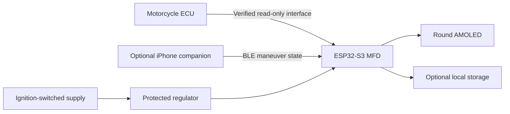

# Interceptor 650 MFD

An experimental, modular auxiliary motorcycle instrument for the 2023 US-spec Royal Enfield Interceptor 650. The project reuses the original Visteon Tripper enclosure and retains the stock analogue instruments.

## Motivation

The original Tripper has never been observed booting. Its enclosure is a candidate for a custom instrument, while its original electronics remain available for diagnostic testing. The initial goal is measuring engine oil temperature, intake air temperature and charging voltage after exhaust/intake changes. No causal link between those changes and the previous regulator/rectifier failure has been demonstrated. Measurements, not assumptions, will inform any subsequent fueling decision.

The expanded product includes optional Tripper-style phone-assisted turn-by-turn guidance and ride analytics. Telemetry must remain independent of the phone and navigation must remain independent of ECU connectivity.

## Status and scope

| Capability | Priority | Status |
|---|---|---|
| Original Tripper diagnosis | P0 | Teardown and passive checks complete; powered test pending |
| Oil temperature, intake air temperature, charging voltage | P0 | Candidate diagnostic data; not verified on target ECU |
| ESP32 display and mock telemetry | P0 | Host model and simulator available; exact board revision and fit pending |
| iOS navigation and hybrid display | P1 | Host decoder and hybrid simulator; phone transport and provider pending |
| Local ride logging | P1 | Integrated host recording, recovery and replay available; card and clock validation pending |
| GPS-tagged ride data, GPX and analytics | P2 | Proposed |
| Phone-independent routing | P3 | Exploratory; not an initial deliverable |

## System overview

The design is provisional. ECU protocol, input connector, module pinout, power circuit, fit and environmental readiness must be verified before implementation or installation.

## Hardware

- Selected Waveshare ESP32-S3-Touch-AMOLED-1.43: vendor advertises 466 × 466 round panel, Wi-Fi/BLE, RTC, TF slot and IMU; verify delivered variant.
- Estimated enclosure internal opening 46–47 mm, depth ~25 mm; not caliper-verified. Do not modify enclosure before physical test fit.
- Original harness and electronics retained. Variable-voltage bench supply is not a verified adjustable-current-limit supply.
- No OBD adapter or permanent automotive regulator selected yet.

## Documentation

| Document | Purpose |
|---|---|
| [Product scope](docs/scope.md) | Proposed features and priorities |
| [Requirements](docs/requirements.md) | Traceable acceptance criteria and dependencies |
| [System architecture](docs/architecture.md) | Power, software, data paths and failure behavior |
| [Application runtime](docs/runtime.md) | State ownership, recording backpressure and boot orchestration |
| [Navigation research](docs/research/navigation.md) | Provider comparison and licensing gates |
| [BLE protocol proposal](docs/protocol/navigation-ble.md) | Versioned phone/display interface |
| [Architecture decisions](docs/adr/README.md) | Decisions, alternatives, unresolved gates |
| [Verification plan](docs/verification.md) | Test matrix and hardware qualification |
| [Diagnostic log](docs/diagnostics.md) | Original PCB and harness measurements |
| [Hardware BOM](hardware/README.md) | Parts and deferred purchases |
| [Host simulator](simulator/README.md) | Run the prototype and view rendered snapshots |
| [Firmware](firmware/README.md) | Candidate PIDs and implementation notes |
| [Roadmap](docs/roadmap.md) | Milestones, dependencies and issue mapping |
| [Agent guidance](AGENTS.md) | Development constraints |

## Development

Clone the repository and start with the requirements and architecture. The portable C++17 telemetry and navigation models drive a local SVG display simulator. See [host build and test instructions](simulator/README.md) and the [Phase 1B verification record](docs/verification-phase-1b.md). GitHub Actions runs host tests on pull requests and pushes to main. Hardware qualification begins with the delivered board's vendor example and requires the physical device. Provider selection remains open.

Track work in [GitHub Issues](https://github.com/SumedhSankhe/interceptor650-mfd/issues). Use reviewable pull requests and preserve empirical records.

## Safety and licensing

This is an independent prototype, not an OEM product or replacement for safety-critical instruments. Do not use it on the road before electrical, mechanical, environmental and usability validation. No ECU writes or actuator commands. No license has been selected for this repository; public visibility does not grant a general redistribution license. Do not commit private rides, identifiers, credentials or third-party navigation content.
