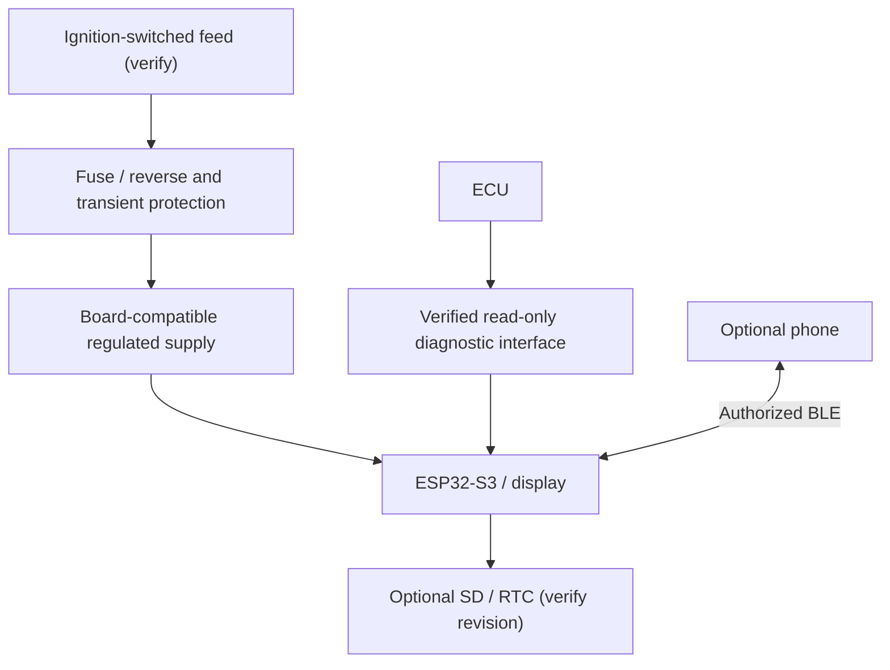
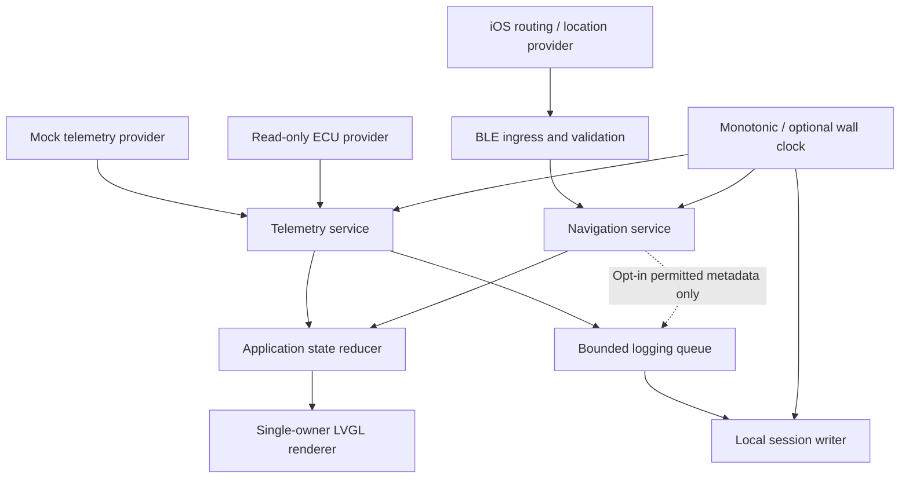

# System architecture

Proposed modular design. [Requirements](requirements.md), [decision log](adr/README.md), [verification](verification.md).

## Physical and electrical boundaries

The protection topology, regulator, harness pinout and fuse rating are TBD after measurement. The original Tripper bench test is a separate path using its original harness and a current-limited source. The new board starts with USB; do not connect directly to 12 V. No changes to the ECU or stock instruments.

## Logical component boundaries

| Component | Responsibility | Boundary |
|---|---|---|
| Board HAL | Display, input, storage, RTC, monotonic clock and power state | Exact pin configuration after bring-up |
| Telemetry provider | Poll candidate ECU metrics, or emit fixture samples | Transport replaceable; no UI calls |
| Telemetry service | Validation, source identity, freshness, last valid samples | No arbitrary diagnostic forwarding |
| Navigation ingress | Authorized GATT connection, decode, sequence and bounds checks | Independent of ECU |
| Navigation service | Maneuver state, freshness, reroute/arrival/disconnect | No route calculation on MCU |
| State reducer | Immutable snapshots and display mode | No blocking I/O |
| Renderer | LVGL task owns objects; consumes latest snapshot | No network or storage I/O |
| Logger | Bounded queue, schema version, timestamp quality, session files | Drops counted; storage failure cannot stall display |
| Phone companion | Route request, progression, reroute, location and BLE | Provider abstraction; no ECU dependency |

Candidate implementation: C++ domain library with injected clock and transport interfaces. Use an ESP-IDF or Arduino vendor-supported framework selected after board bring-up; PlatformIO is a candidate build front end, not an approved configuration. Use queues/latest-value mailboxes; no shared mutable LVGL objects across tasks. Schedule transport I/O with bounded timeouts and backoff; do not block rendering on reconnect. Avoid hard-coded CPU affinity until measured.

## Data contracts

Telemetry sample: metric identifier, numeric value in canonical SI or volts, source identifier, monotonic acquisition time, quality (valid, unsupported, stale, error, simulated). Preserve last valid value internally but show stale/missing explicitly. Wall clock optional and independently qualified. Navigation state is defined in [BLE proposal](protocol/navigation-ble.md). Phone and ECU connectivity are separate. The host simulator feeds synthetic v1 packets into the portable navigation model and renders its snapshot alongside independent mock telemetry. The transport must bind packet callbacks to the current authorized link and count semantic rejections using the decoder result.

## Failure behavior

| Failure | Required behavior |
|---|---|
| ECU missing/unsupported | Mark affected measurements unavailable; navigation remains functional |
| Phone disconnected/route invalid | Remove current turn arrow/distance; telemetry remains functional |
| Malformed payload | Reject without state mutation; count error; never refresh age |
| Storage unavailable/full | Report logging disabled/degraded; continue rendering |
| No clock synchronization | Use relative monotonic time; don't fabricate UTC |
| Restart/brownout | Start with unavailable data, no previous session shown as live |
| Render/task overload | Bounded queues; expose diagnostics; prioritize recent valid snapshots |

## Power and storage

Prefer functions integrated into the verified Waveshare ESP32-S3 AMOLED module. An ignition-switched interface supplies the device. External circuits provide necessary compatibility and automotive protection. The approved design excludes a main backup battery, supercapacitor, external shutdown controller and custom shutdown circuitry. Optional RTC backup is deferred. Measure power and thermal behavior during boot, radio use and brightness extremes.

One recorder runs on a dedicated storage worker and accepts snapshots
independently of navigation. It opens a session at boot or once storage is
available, samples available data through engine stops and ECU gaps, and
requests sync periodically and on a fresh running-to-stopped observation.
A stop may reflect a stall or kill switch. The supply can disappear without
an observed stop. The future embedded adapter should receive snapshots
through the bounded logging queue. Storage calls belong outside acquisition,
display and navigation tasks.

Recovery inspects valid prefixes of interrupted logs without reopening them
for append. A new boot allocates a different session ID while retained files
are present. The v1 recording contains no location or proprietary provider
content. Future GPS logging remains opt-in and limited to permitted data.
See the [ride recording format and lifecycle](protocol/ride-recording.md)
and [storage test plan](verification.md).
