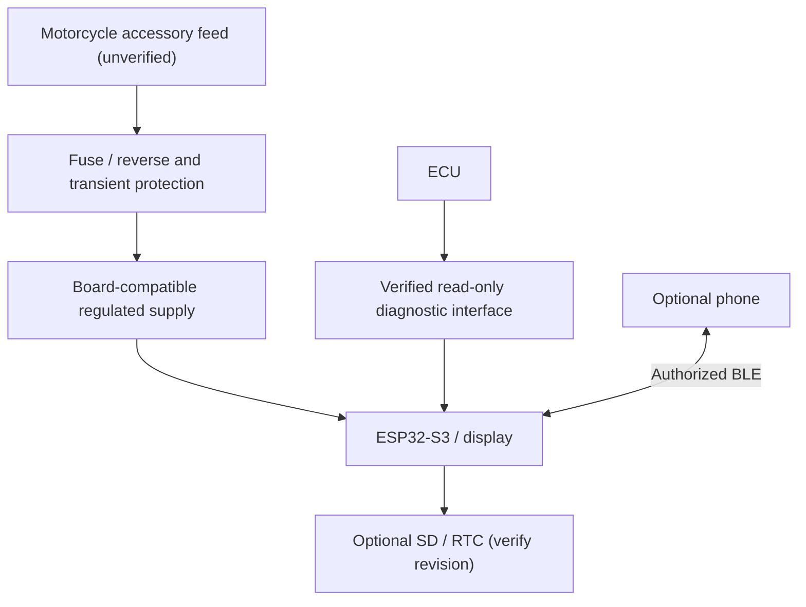
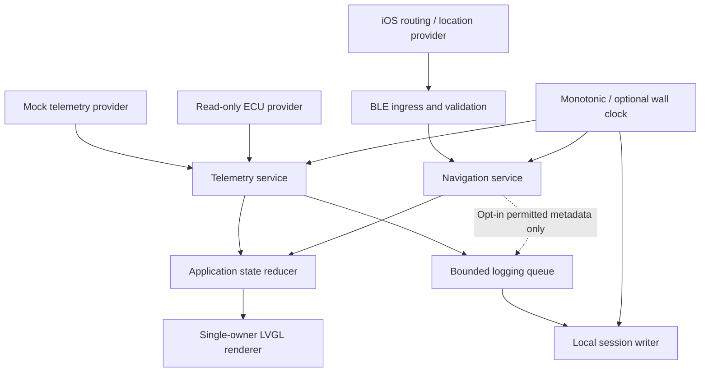

# System architecture

Proposed modular design. [Requirements](requirements.md), [decision log](adr/README.md), [verification](verification.md).

## Physical and electrical boundaries

The protection topology, regulator, harness pinout and fuse rating are TBD after measurement. The original Tripper bench test is a separate path using its original harness and a current-limited source. The new board starts with USB; do not connect directly to 12 V. No changes to the ECU or stock instruments.

## Logical component boundaries

| Component | Responsibility | Boundary |
|---|---|---|
| Board HAL | Display, input, storage, RTC, monotonic clock and power state | Exact pin configuration after bring-up |
| Telemetry provider | Poll candidate ECU metrics, or emit fixture samples | Transport replaceable; no UI calls |
| Telemetry service | Validation, source identity, freshness, last valid samples | No arbitrary diagnostic forwarding |
| Navigation ingress | Authorized GATT connection, decode, sequence and bounds checks | Independent of ECU |
| Navigation service | Maneuver state, freshness, reroute/arrival/disconnect | No route calculation on MCU |
| State reducer | Immutable snapshots and display mode | No blocking I/O |
| Renderer | LVGL task owns objects; consumes latest snapshot | No network or storage I/O |
| Logger | Bounded queue, schema version, timestamp quality, session files | Drops counted; storage failure cannot stall display |
| Phone companion | Route request, progression, reroute, location and BLE | Provider abstraction; no ECU dependency |

Candidate implementation: C++ domain library with injected clock and transport interfaces. Use an ESP-IDF or Arduino vendor-supported framework selected after board bring-up; PlatformIO is a candidate build front end, not an approved configuration. Use queues/latest-value mailboxes; no shared mutable LVGL objects across tasks. Schedule transport I/O with bounded timeouts and backoff; do not block rendering on reconnect. Avoid hard-coded CPU affinity until measured.

## Data contracts

Telemetry sample: metric identifier, numeric value in canonical SI or volts, source identifier, monotonic acquisition time, quality (valid, unsupported, stale, error, simulated). Preserve last valid value internally but show stale/missing explicitly. Wall clock optional and independently qualified. Navigation state is defined in [BLE proposal](protocol/navigation-ble.md). Phone and ECU connectivity separate.

## Failure behavior

| Failure | Required behavior |
|---|---|
| ECU missing/unsupported | Mark affected measurements unavailable; navigation remains functional |
| Phone disconnected/route invalid | Remove current turn arrow/distance; telemetry remains functional |
| Malformed payload | Reject without state mutation; count error; never refresh age |
| Storage unavailable/full | Report logging disabled/degraded; continue rendering |
| No clock synchronization | Use relative monotonic time; don't fabricate UTC |
| Restart/brownout | Start with unavailable data, no previous session shown as live |
| Render/task overload | Bounded queues; expose diagnostics; prioritize recent valid snapshots |

## Power and storage

Estimate power and thermal budgets with measured current at brightness extremes, boot and radio activity. No lithium battery required in initial design. Use append-only session records with version, units, source, time quality and validity; flush policy, filesystem and storage wear to be measured. Retain completed files on abrupt ignition-off; do not log proprietary provider road names, speed limits or route geometry. GPS logging is optional and restricted to permitted independent data.
