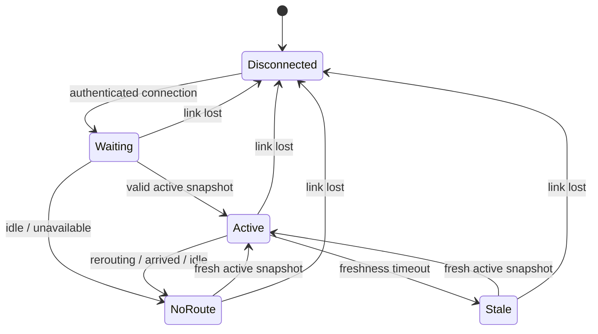

# Navigation BLE protocol v0 proposal

Status: v1 frame decoding and lifecycle are implemented for host verification. Physical transport and pairing remain proposed. Provider-independent; no proprietary map data in required payload. iPhone central, ESP32 peripheral/GATT server. Device-specific service/characteristic UUIDs are TBD; generate and record once implementation begins. No ECU command characteristic.

## Transport

Use one encrypted, authorized write-with-response characteristic for fixed-size full navigation snapshots; optional read/notify status characteristic for device capability/version and applied sequence. A write response acknowledges transport, not semantic acceptance. Use an explicit pairing window while stationary and authenticated LE Secure Connections if board/app support suitable user confirmation; otherwise document the weaker pairing model and do not enable riding use until unauthorized writes are prevented. Reject unpaired clients, allow one authorized phone, provide stationary bond reset. Validate iOS background behavior on physical device.

## Frame v1 (20 bytes, little endian)

Fits the 20-byte value capacity of default ATT MTU 23. Do not depend on MTU negotiation. Exact length; no fragmented/partial snapshots.

| Offset | Bytes | Field | Meaning |
|---|---:|---|---|
| 0 | 1 | version | 1 |
| 1 | 1 | state | 0 idle, 1 active, 2 rerouting, 3 arrived, 4 unavailable |
| 2 | 1 | maneuver | 0 unknown, 1 straight, 2 left, 3 right, 4 U-turn, 5 roundabout, 6 slight left, 7 slight right, 8 keep left, 9 keep right |
| 3 | 1 | flags | bit 0 distance valid; bit 1 exit valid; other bits zero |
| 4 | 4 | session_id | Random per active connection/session, not authentication |
| 8 | 4 | sequence | Strictly increasing within session |
| 12 | 4 | distance_m | Nonnegative distance to next maneuver; zero is valid only with flag |
| 16 | 1 | exit_number | Nonzero only when exit valid and roundabout |
| 17 | 3 | reserved | All zero |

For active state, require a supported maneuver and distance-valid flag before showing guidance; unknown maneuver displays unavailable, not straight. For non-active state require maneuver/flags/distance/exit zero. If exit unavailable use zero. Sequence starts at 1; reconnect starts a new session and requires a new snapshot; wrap requires a new session after explicit reset. Reject unknown version/state/flags, bad length, out-of-order/duplicate sequence, invalid combinations and unexpected session. Do not refresh accepted-state timer on rejection. A session ID is not a security token.

## Lifecycle

Publish complete snapshots on material changes and approximately every second while active (initial test target). A new sequence alone cannot make stale provider information fresh: companion must explicitly send unavailable if route/location state is stale. Display uses local monotonic reception age; after 3 s without accepted active state, suppress arrow and distance. Disconnect clears guidance immediately. Never reuse state across connection. No phone clock synchronization required for freshness.

## Host interpretation for protocol review

- The proposal does not reserve a session ID. The decoder accepts any unsigned 32-bit ID, including zero, and uses explicit presence internally. Propose preserving this full range in v1.
- The active-state paragraph calls unknown guidance unavailable while also requiring a supported maneuver. The host treats active with unknown maneuver as an invalid combination and leaves the last accepted snapshot and its original age intact. Propose requiring the sender to publish an explicit unavailable snapshot when it cannot supply a supported maneuver.
- Sequence 1 establishes the session. Subsequent complete snapshots may skip sequence numbers. The last accepted session ID cannot reopen on the next link, and a duplicate connection notification cannot reset ordering. Propose clarifying that the transport drops callbacks from prior link instances and the sender chooses a new ID after reconnect or sequence exhaustion. The decoder tracks the immediately previous session, leaving transport authentication and cross-link isolation to the authorized transport.
- Distance uses the complete unsigned 32-bit range. The active snapshot expires at 3000 ms inclusive. Idle, rerouting, arrived and unavailable contain no guidance and remain visible until the next snapshot or disconnect.

The frame format and the published test vectors are unchanged.

## Deferred fields

Road name, ETA and remaining trip distance can be added as separately versioned bounded metadata only after provider terms and usability review; no provider-owned metadata is persisted. No GPX geometry or arbitrary text in v1. For forward compatibility unknown versions are rejected, not guessed. No MCU-to-ECU bridging.

## Test vectors (hex, proposed)

Active right turn, 400 m, session 1, sequence 1:
`01 01 03 01 01 00 00 00 01 00 00 00 90 01 00 00 00 00 00 00`

Rerouting, same session, sequence 2:
`01 02 00 00 01 00 00 00 02 00 00 00 00 00 00 00 00 00 00 00`

Host validation includes both vectors, truncation, version and enum rejection, replay, field validity, reconnect, freshness, and explicit unavailable state. See the [Phase 1B V05 record](../verification-phase-1b.md).
