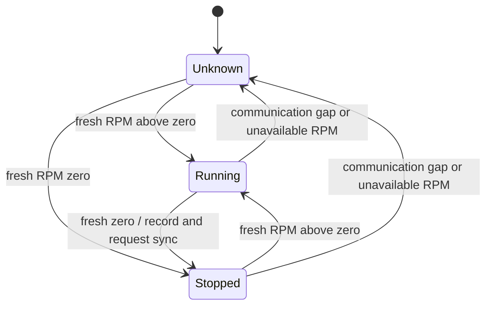
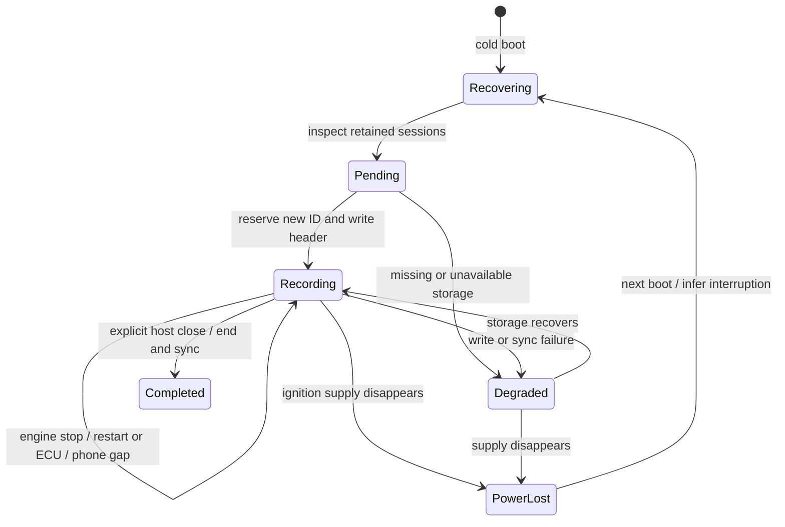

# Ride recording and settings v1

Phase 1C host contract. See [ADR-008 and ADR-009](../adr/README.md),
[requirements](../requirements.md) and [Issue #6](https://github.com/SumedhSankhe/interceptor650-mfd/issues/6).

## Engine and session lifecycle

Only a fresh valid or simulated RPM with ECU connectivity drives engine state.
Zero means stopped. Positive means running. Missing, stale, unsupported or
error means unknown. RPM alone cannot distinguish a stall from a kill-switch
stop. PID `010C` is a candidate and compatibility remains unverified.

On boot, inspect retained logs and initialize a new recorder. The first
sampling tick reserves a session and records the available values even with a
stopped or unknown engine. If storage is missing, reserve on recovery during
the same boot. A stop, ECU gap, or phone disconnect leaves the session open.
If the supply persists during a stop or ECU gap, continue sampling available
telemetry such as independently measured voltage. During an ECU gap, the recorder masks RPM and ECU-sourced readings even if an old cached sample has not reached its freshness limit. The host simulator
replays scenarios from scratch and keeps synthetic recording data in memory.

The recorder uses a supplied monotonic clock. It samples once per second and
requests sync every five seconds from boot or the last request. A direct
running-to-stopped transition writes immediately and requests sync, coalesced
with a periodic request if both are due. The next sample interval starts at
the most recent attempt. Work missed while unavailable is skipped, with a
cumulative error count in the next successful sample. The recorder belongs
on a storage worker and has no navigation input. The host adapters use one
writer per storage directory/path.

## CSV schema

Versioned, checksummed CSV was chosen over JSON Lines because fields are
bounded numbers or predefined enums, the reader needs no JSON dependency,
and a newline-delimited prefix stays inspectable. JSON Lines would be
self-describing and better suited to extensible text fields. v1 CSV
requires an explicit column contract and does not accept quoting or free text.

Records are ASCII, end with LF, and use a final comma followed by the
eight hexadecimal digits of CRC-32/ISO-HDLC over the preceding payload.
The LF and checksum separator are excluded from CRC input. CRC detects
accidental damage and is not authentication. File names are
`<id>.csv`, where the host takes the next available ID above retained
numeric session files. IDs are unique within the retained directory.

| Type | Payload before checksum |
|---|---|
| Begin | `1,id,B` |
| Sample | `1,id,S,elapsed_ms,unix_ms,clock,engine,ecu,storage_errors,oil_c,oil_quality,intake_c,intake_quality,voltage_v,voltage_quality,voltage_source,rpm,rpm_quality` |
| End | `1,id,E,elapsed_ms` |

- Elapsed milliseconds are relative to boot and nondecreasing. Optional
  signed UTC epoch milliseconds have `trusted` or `unverified` quality.
  An empty UTC field has `unknown` quality.
- Engine is `running`, `stopped` or `unknown`. ECU communication is
  `1` for connected and `0` for a gap. Numeric fields are blank for
  `missing`, `stale`, `unsupported` or `error`. A `valid` or
  `simulated` reading contains a finite numeric value, with zero distinct
  from blank. Oil and intake are degrees Celsius, voltage is volts, and
  engine speed is revolutions per minute.
- Voltage source is `none`, `mock`, `ecu`, `adapter` or `battery`.
  Storage errors count failed reserve, append and sync operations. The
  latest error and session status remain available in memory during an
  outage. A full or absent device cannot reliably record its own errors.
- The format contains telemetry and operational state only. It has no
  personal location or provider-specific content.

## Recovery and synchronization

A recovered file is empty, interrupted at a complete record boundary,
truncated mid-record, corrupt at validation, completed with a valid final
end record, or unavailable. The scanner checks bounded line length, CRC,
version, field count, enums, units, file/session ID, ordering and record
boundaries. It stops at the first invalid record and reports the valid
prefix byte count and sample count. Recovery reads previous files without
editing them. It never appends to a previous power cycle. An end marker is
reserved for explicit close, so a missing marker is inferred interruption,
without an asserted cutoff time or engine stop.

Within the current boot, a retry trims any unacknowledged tail before
appending. A shortened or missing committed prefix fails safely. If the
active file disappears and the medium returns without it, recording stays
degraded for that session. Replacing media mid-session is outside this host
contract.

The host file adapter closes each record stream, draining its C application
buffer to the OS. Sync requests use `fsync` on POSIX and `_commit` on Windows
for file data. Directory metadata and device write caches are outside that
file-sync guarantee. The one-second and five-second intervals are
engineering targets, with no physical microSD durability or loss-bound
claim. Existing files may still be affected by physical filesystem or media
damage. V09 requires fault tests with the actual card, filesystem, power and
clock.

## Settings v1

A separate checksummed CSV line stores
`1,temperature_unit,distance_unit,display_mode`. Temperature indices
are Celsius 0 and Fahrenheit 1. Distance indices are metric 0 and
imperial 1. Display indices are telemetry 0, navigation 1 and hybrid 2.
Defaults are the zero values. The model writes changed values only and
keeps the current preferences if persistence fails. Invalid CRC, truncation,
unknown version, invalid enum or missing file falls back to defaults.

The host adapter writes and file-syncs a same-directory temporary file
before replacement. If interrupted, reads use only the installed settings
file. Metadata durability under power loss remains dependent on the
filesystem. Stored preferences carry neither guidance nor current sensor
values. Embedded persistence and RTC backup remain deferred.
