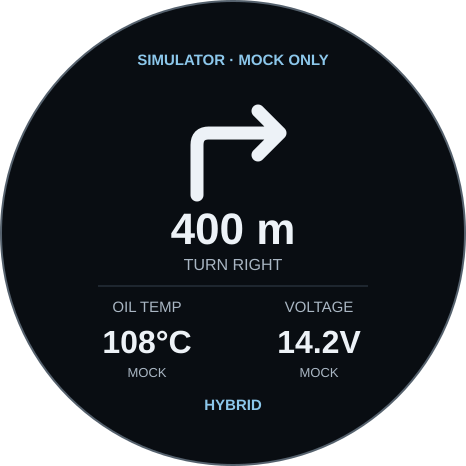
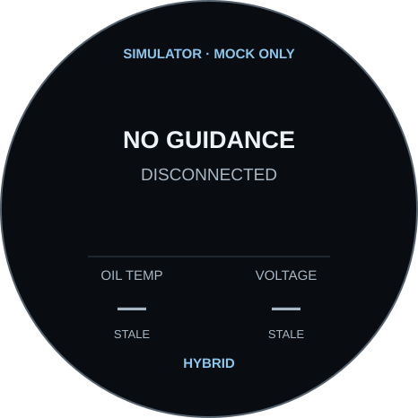

# Host MFD simulator

A 466 × 466 circular SVG display, driven by the same portable C++17 telemetry model intended for later embedded integration. Python standard library only at runtime; no internet or hardware required. Navigation is a deterministic visual fixture, not an implemented BLE protocol or route provider. No LVGL or ESP32 build is included.

## Preview

| Telemetry | Hybrid | Degraded |
|---|---|---|
|  |  |  |

These are actual renderer outputs, not artist mockups or physical display photographs. They are checked against generated SVG in the test suite.

## Build and run

From the repository root on Linux, or Windows using WSL with a C++17 compiler and Python 3 installed (WSL/macOS not tested here):

```sh
mkdir -p simulator/build
g++ -std=c++17 -Wall -Wextra -Werror -pedantic -Ifirmware/include firmware/test/telemetry_test.cpp -o simulator/build/telemetry_test
./simulator/build/telemetry_test
g++ -std=c++17 -Wall -Wextra -Werror -pedantic -Ifirmware/include simulator/fixture.cpp -o simulator/build/fixture
python3 simulator/test_render.py
python3 simulator/server.py
```

Open http://127.0.0.1:8765 in a desktop browser. Use the selectors to change mode, telemetry fixture, navigation fixture and temperature units. The server is loopback-only. Stop with Ctrl-C.

## Architecture

- `firmware/include/mfd/telemetry.hpp`: portable data model, source/quality validation, monotonic freshness and unit conversion.
- `firmware/test/telemetry_test.cpp`: deterministic assertion checks.
- `fixture.cpp`: command-line mock provider and JSON bridge; no real ECU data.
- `render.py`: SVG viewport; navigation fixture and telemetry are independently selectable.
- `server.py` and `index.html`: desktop-only HTTP bridge and controls.
- `test_render.py`: 96 mode/fixture/unit combinations, invalid selectors and snapshot consistency.
- `screenshots/`: reproducible 466 × 466 SVG outputs.

## Validation record

Local Linux: GCC 14.2.0, Python 3.13.5. Strict C++17 compilation and assertion executable passed; Python renderer suite passed all three test methods, including 96 combinations; local HTTP responses checked against renderer for all 96 combinations, Fahrenheit display and invalid-selector HTTP 400. Three SVG snapshots captured and rasterized to PNG for inspection. The browser environment blocked navigation, so interactive browser controls were not end-to-end tested; verify locally. No embedded build, real sensors, Bluetooth, GPS, or environmental tests run. No temperature or voltage alarm thresholds defined. V02 is partially addressed, not a hardware validation pass.

## Next

Review visual hierarchy at actual 1.43-inch scale; run browser interaction locally. Add portable navigation state/decoder tests separately, then board-specific LVGL adaptation after exact module revision and vendor example are verified. No paid provider or permanent electrical design selected.
