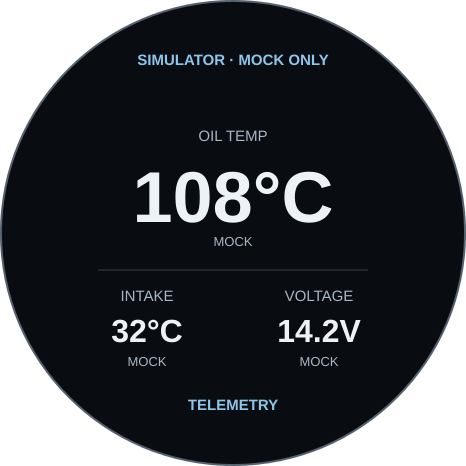

# Host MFD simulator

A 466 × 466 circular SVG display, driven by portable C++17 telemetry and navigation models intended for later embedded integration. The Python standard library and compiled fixture run entirely on loopback. Synthetic v1 packets and explicit link events exercise the same decoder and freshness checks covered by the host tests.

## Preview

| Telemetry | Hybrid | Degraded |
|---|---|---|
|  |  |  |

These are actual renderer outputs, not artist mockups or physical display photographs. They are checked against generated SVG in the test suite.

## Build and run

From the repository root on Linux, or Windows using WSL with a C++17 compiler and Python 3 installed (WSL/macOS not tested here):

```sh
mkdir -p simulator/build
g++ -std=c++17 -Wall -Wextra -Werror -pedantic -Ifirmware/include firmware/test/telemetry_test.cpp -o simulator/build/telemetry_test
./simulator/build/telemetry_test
g++ -std=c++17 -Wall -Wextra -Werror -pedantic -Ifirmware/include firmware/test/navigation_test.cpp -o simulator/build/navigation_test
./simulator/build/navigation_test
g++ -std=c++17 -Wall -Wextra -Werror -pedantic -Ifirmware/include firmware/test/recording_test.cpp -o simulator/build/recording_test
./simulator/build/recording_test
g++ -std=c++17 -Wall -Wextra -Werror -pedantic -Ifirmware/include firmware/test/application_test.cpp -o simulator/build/application_test
./simulator/build/application_test
g++ -std=c++17 -Wall -Wextra -Werror -pedantic -Ifirmware/include simulator/fixture.cpp -o simulator/build/fixture
python3 simulator/test_render.py
python3 simulator/server.py
```

Open http://127.0.0.1:8765 in a desktop browser. Select a display mode and independent telemetry and navigation fixtures. Choose a maneuver, distance in meters and optional roundabout exit. Distance and temperature display units are independent. Set elapsed time to 3000 ms to expire active guidance. The navigation session control replays either a reconnect awaiting a packet or a reconnect with a fresh packet. The desktop ride diagnostics panel replays ignition, engine, storage and recovery scenarios against the C++ recorder. Select Integrated ride timeline and choose a replay step or use Next replay step. The display and diagnostics consume the same runtime snapshot. Fixture controls remain available for individual regressions. Each request deterministically replays synthetic data in memory. The server is loopback-only. Stop with Ctrl-C.

## Browser tests

Build the fixture using the commands above, or use the native Windows build
in the [Phase 1D verification record](../docs/verification-phase-1d.md). From the
repository root with Node.js and npm installed:

```sh
cd simulator
npm ci
npx playwright install chromium
npm test
```

The test launcher starts the loopback simulator on an available port, passes it
to Playwright and stops the server when the browser suite exits. Chromium
uses the same controls as a desktop user. Set `SIMULATOR_PYTHON` to a Python executable
if needed, or `SIMULATOR_TEST_PORT` to use another port. To test an already
running local instance, set `SIMULATOR_USE_RUNNING_SERVER=1` and match its
`server.py --port` value with `SIMULATOR_TEST_PORT` (default 18765 for an external server).

Set `SIMULATOR_SCREENSHOTS` to a directory to regenerate the PNG evidence. See the [Phase 1D captures](screenshots/phase-1d/) for integrated replay, backpressure and recovery.
The [Phase 1B captures](screenshots/phase-1b/) and the [verification record](../docs/verification-phase-1b.md)
show the tested states and visual observations. The original [V02 capture set](screenshots/browser/) is retained as historical evidence. The browser
dependencies are only required to develop or run this test suite.

## Architecture

- `firmware/include/mfd/telemetry.hpp`: portable data model, source/quality validation, monotonic freshness and unit conversion.
- `firmware/test/telemetry_test.cpp`: deterministic assertion checks.
- `firmware/include/mfd/navigation.hpp`: v1 packet validation, session ordering and monotonic freshness.
- `firmware/test/navigation_test.cpp`: protocol vectors, lifecycle assertions and seeded malformed inputs.
- `firmware/include/mfd/engine.hpp`, `recording.hpp`, `record_format.hpp` and `settings.hpp`: portable state, lifecycle, format and settings.
- `firmware/host/`: filesystem and deterministic in-memory adapters.
- `firmware/include/mfd/application.hpp`: single-owner reducer, snapshot mailbox and recording FIFO.
- `fixture.cpp` and `runtime_fixture.hpp`: deterministic runtime replay and snapshot projection.
- `render.py`: SVG viewport; navigation fixture and telemetry are independently selectable.
- `server.py` and `index.html`: desktop-only HTTP bridge and controls.
- `test_render.py`: 168 mode/fixture/unit combinations, invalid selectors and snapshot consistency.
- `screenshots/`: reproducible 466 × 466 SVG outputs.

## Earlier Linux validation

Local Linux: GCC 14.2.0, Python 3.13.5. Strict C++17 compilation and assertion executable passed; Python renderer suite passed all three test methods, including 96 combinations; local HTTP responses checked against renderer for all 96 combinations, Fahrenheit display and invalid-selector HTTP 400. Three SVG snapshots captured and rasterized to PNG for inspection. The browser environment blocked navigation, so interactive browser controls were not end-to-end tested; verify locally. No embedded build, real sensors, Bluetooth, GPS, or environmental tests run. No temperature or voltage alarm thresholds defined. V02 is partially addressed, not a hardware validation pass.

## Next

Review visual hierarchy at actual 1.43-inch scale. Board-specific LVGL adaptation depends on the exact module revision and vendor example. No paid provider or permanent electrical design selected.
